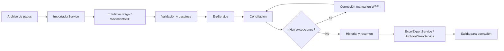
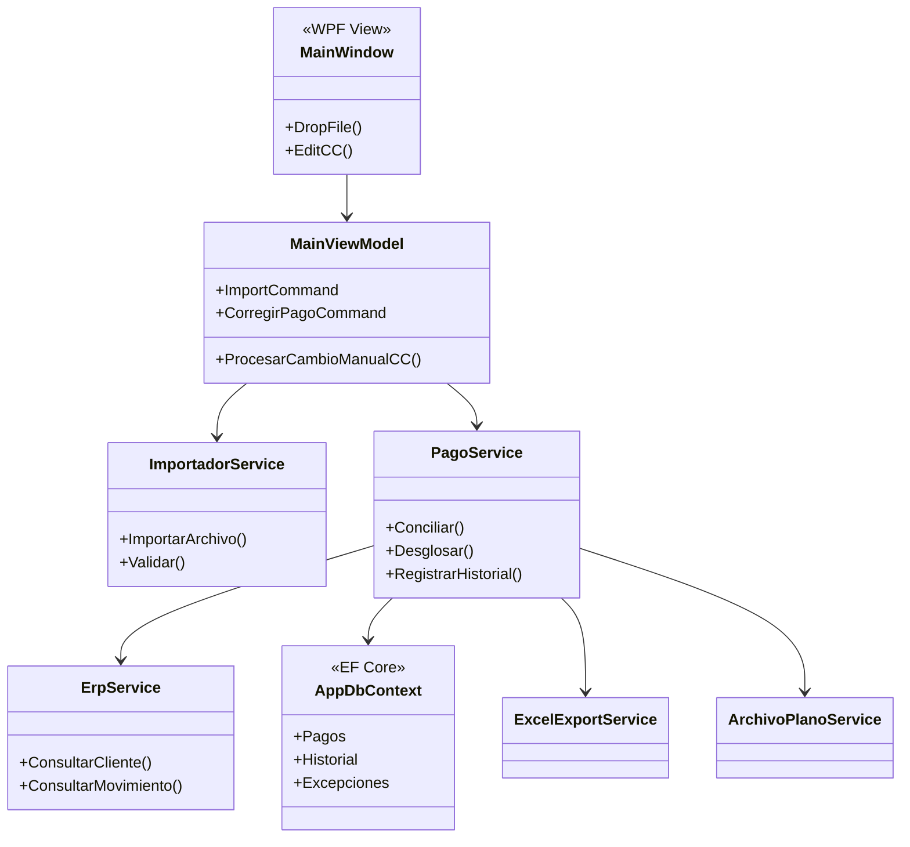

# GestorPagos

Aplicación de escritorio WPF/.NET para importar, validar, conciliar y exportar pagos. La solución está organizada por capas para que la lógica de pagos pueda evolucionar sin quedar embebida en la interfaz.

## Propósito

El sistema recibe archivos de pagos, construye entidades de dominio, consulta o cruza información ERP, permite corregir manualmente centros de costo y produce resultados para conciliación y exportación.

## Flujo principal



## Arquitectura por capas



## Componentes

- `GestorPagos.UI`: WPF, `MainWindow`, ViewModels, comandos y diálogos de corrección.
- `GestorPagos.Core`: entidades (`Pago`, `ClienteERP`, `MovimientoCC`, `ExcepcionPago`), modelos de resumen e interfaces.
- `GestorPagos.Data`: `AppDbContext` y servicios de ERP/procesamiento.
- `.config`: herramientas de desarrollo .NET.
- `check.sql`, `check_desglose.ps1` y `validar_api.ps1`: utilidades de diagnóstico.

## Decisiones técnicas

| Decisión | Motivo | Implicación |
|---|---|---|
| Separar UI, Core y Data | Mantener la lógica de negocio reutilizable | La UI depende de contratos, no de consultas concretas. |
| MVVM en WPF | Facilitar comandos, pruebas y corrección manual | El `MainViewModel` orquesta la interacción. |
| Entidades explícitas de conciliación | Un pago puede tener desglose, excepción e historial | La trazabilidad no se reduce a una sola fila. |
| Interfaces para importación y ERP | Permitir cambiar formato o proveedor | Los adaptadores se pueden sustituir sin reescribir la UI. |
| Base local fuera del repositorio | `gestorpagos_local.db` es estado de ejecución | Se evita publicar información operativa. |
| Excluir el archivo Windows `nul` | Es un nombre reservado que rompe sincronizadores | Se conserva la solución sin arrastrar el artefacto inválido. |

## Ejecución

```powershell
dotnet restore GestorPagos.sln
dotnet build GestorPagos.sln
dotnet run --project GestorPagos.UI/GestorPagos.UI.csproj
```

La operación habitual es arrastrar un archivo a la ventana, revisar las filas con excepción, corregir el centro de costo cuando aplique y exportar el resultado.

## Seguridad y datos

No se deben versionar bases SQLite, credenciales, archivos de producción ni exportaciones con datos personales. Los JSON de muestra se conservan únicamente como fixtures de prueba y el repositorio debe mantenerse privado.
